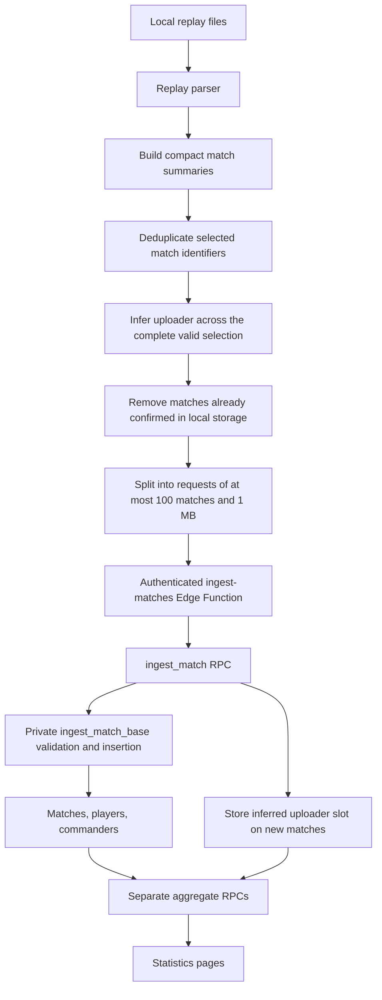

# Replay statistics: architecture and decisions

This is the reference for changing upload attribution and statistics queries.
For dashboard deployment steps and troubleshooting, see
[statistics-backend.md](statistics-backend.md). For Google login, see
[authentication.md](authentication.md).

## Data flow and source files



| Responsibility | Source |
| --- | --- |
| Decode replay and build player/unit analysis | `src/parser/sovlReplay.ts`, `replayFormat.ts` |
| Map recorded faction codes | `src/parser/catalogue.ts` |
| Build payload and match fingerprint | `src/parser/statistics.ts` |
| Infer uploader from a bulk selection | `src/parser/uploaderInference.ts` |
| Local cache, batching, HTTP request, response counts | `src/services/statisticsUpload.ts` |
| Trigger submission for loaded files | `src/components/StatisticsUpload.tsx` |
| Verify user and forward each match to SQL | `supabase/functions/ingest-matches/handler.ts` |
| Supabase client and Edge Function environment setup | `src/services/supabase.ts`, `supabase/functions/ingest-matches/index.ts` |
| Hash routes and link visibility | `src/navigation.ts`, `src/App.tsx` |
| Select aggregate RPC and validate its response | `src/services/globalStatistics.ts` |
| Shared statistics layout and charts | `src/components/GlobalStatistics.tsx`, `FactionPieChart.tsx`, `PlayerAppearancesChart.tsx` |

Raw replay files, army lists, and event streams stay in the browser. Bundled
sample loading does not submit statistics. A failed backend request must not
prevent local replay analysis. User-selected files submit automatically after
successful parsing while signed in; upload results are logged to the console.

## Payload contract

Example structure; the fingerprint below is a placeholder:

```json
{
  "identifier": "sovl-match-v1:<64 lowercase SHA-256 hex characters>",
  "recordedUtc": "2026-11-12T20:36:27.680Z",
  "players": [
    {
      "name": "Cruz",
      "faction": "AbyssalDemons",
      "commanders": ["abyssalHerald", "abyssalPrince"],
      "result": "draw"
    },
    {
      "name": "Holmelund_DK",
      "faction": "UndyingDynasties",
      "commanders": ["hierophant", "risenKing"],
      "result": "draw"
    }
  ],
  "winner": null,
  "scoreDifference": 49,
  "uploader": "Cruz"
}
```

- `players` is sorted alphabetically by normalized display name using JavaScript
  ordinal comparison, with score as the tie-breaker. It is not original replay
  player order. Display names are trimmed and Unicode-normalized to NFC.
- A player and their score must remain paired when sorting.
- Array positions become database `player_slot` values 0 and 1.
- `scoreDifference` is sorted player 0's final score minus sorted player 1's.
- `winner` is the winning display name, or `null` for an explicitly recorded draw.
  Recorded outcomes are authoritative. The project owner confirmed that close
  scores can be draws; the supplied 403–354 result is correctly a draw. Do not
  infer a winner from the sign of the score difference.
- Commander arrays contain stable type IDs, not custom names. Include both
  attached characters and standalone entries in the army's Commanders section.
  Preserve copies in the payload; aggregation deduplicates types per army/match.
- `uploader` is a heuristic replay-player attribution, not the Google account
  email or Supabase user UUID. It is the exact matching payload name or `null`.
- Old clients may omit `uploader`; the backend treats it as unknown.
- Game/balance versions exist in analysis, but are not currently sent or populated
  in the optional database version columns. Patch-filtered statistics are not
  implemented. Do not claim version coverage based only on those columns existing.

### Identifier stability

The v1 fingerprint hashes a JSON object with fields in this order:

1. `recordedUtc`, normalized to ISO UTC with JavaScript millisecond precision.
2. `players`, the sorted array of `{ name, score }` pairs.
3. `mapId`, the recorded map identifier.

The resulting identifier is `sovl-match-v1:` plus SHA-256 hex. This is a hash of
match metadata, not a replay-file hash. The raw scores and map ID participate in
the fingerprint but are not separate fields in the transmitted summary.

Faction, commanders, winner, and inferred uploader do not participate in the
fingerprint. Correcting those fields or changing the bulk selection must not
create a new match identity. Name case is significant in the fingerprint even
though uploader inference groups names case-insensitively.

We have not verified that opposing players' saved copies share `recordedUtc`.
Cross-player duplicate detection is therefore not guaranteed. There is no shared
match ID in the inspected replay files. Changing fingerprint semantics requires
an explicit versioning/deduplication plan, not just a code edit.

## Uploader inference

Inference applies to the current bulk selection, not a permanent account profile
or an accumulation of previous selections. It operates on valid payloads before
the local-storage cache and request batching are applied.

1. Deduplicate games by match identifier.
2. Require at least two distinct valid games.
3. Normalize names with NFC, trim, and lowercase. Count each normalized name at
   most once per game.
4. Choose the name with a uniquely highest count, provided it appears at least
   twice. A majority is not required, and the player need not appear in every game.
5. If the top count is tied, leave the entire selection unattributed.
6. Annotate a game only when the inferred name identifies exactly one of its
   sides. Otherwise that game's `uploader` is `null`.

| Selected distinct games | Inference |
| --- | --- |
| A–B | None: single game |
| A–B, A–C | A |
| A–B, A–B | None: both names appear equally often |
| A–B, A–C, D–E | A for the first two; unknown for D–E |
| Same file selected repeatedly | Still one game; cannot establish an uploader |

One cached game and one new game can establish the uploader for the new game,
because inference occurs before cached matches are removed. Single-file uploads
remain unknown even if the same account previously uploaded a larger batch.

This is intentionally an estimate. Shared files, repeat opponents, renamed
players, unrelated collections, and duplicate display names can limit or mislead
inference. A verified submitter-to-player relationship would need a different
data model; the current payload cannot prove it.

## Persistence and authorization

| Table | Important fields and meaning |
| --- | --- |
| `matches` | Unique `identifier`; `recorded_utc`; insertion `created_at`; nullable `winner_slot`; signed `score_difference`; nullable `inferred_uploader_slot` |
| `match_players` | Composite key `(match_identifier, player_slot)`; display name, faction ID, result |
| `match_commanders` | Match and player slot plus `commander_index`; commander type ID; allows repeated types |

The Edge Function verifies the bearer token with `auth.getUser()`, then calls SQL
using that same user's Authorization header. A publishable key alone is not a
user session. Direct table access remains blocked to browser roles.

The inferred-uploader migration renames the original insert function to
`ingest_match_base(jsonb)`, revokes browser execution of that base, and exposes an
authenticated `ingest_match(jsonb)` wrapper. The wrapper validates that a non-null
uploader identifies exactly one payload player, calls the existing validated
insert, and stores the matching slot only if a new match was inserted. All of
this happens in the same database transaction.

The wrapper validates membership in the match; it does not prove that the caller
is that player or recompute the bulk inference. The server receives summaries,
so it cannot independently verify the original replay's contents either.
The identifier is supplied by the browser: because raw scores and map ID are
not sent separately, the current backend cannot recompute that fingerprint.

### Duplicates, cache, and corrections

- Database identifiers are the final uniqueness constraint. A duplicate does not
  update match data, upload time, or uploader attribution. First stored data wins.
- Local storage key: `sovl-uploaded-matches-v1:<endpoint URL>`. It stores confirmed
  inserted/duplicate identifiers, scoped to the endpoint, not the signed-in user.
- Rejected entries and failed requests are not cached. For partially successful
  requests, only entries identifiable as successful are cached. Browser storage
  failures do not turn a successful upload into a failure.
- A timed-out request may already have committed. Retrying is safe for duplicate
  counting, but does not overwrite earlier records.
- Clearing local storage only causes another request. It does not backfill old
  `null` uploader slots or correct old unknown factions/missing commanders.
- Backfills require a separate, reviewed database operation based on evidence.
  Do not assume a frequent player name proves who submitted historical matches.
  See [manual uploader backfill queries](statistics-operations.md#manually-backfill-a-known-uploader).

## Statistics pages and counting rules

All three pages use `GlobalStatistics` and fetch a separate signed-in RPC on
entry/Refresh. They do not download all individual records to aggregate locally.
The faction filter affects result tables; overview counts and pie charts describe
the whole endpoint selection.

| Route | RPC | Selection and contribution |
| --- | --- | --- |
| `#/statistics` | `global_statistics()` | All complete two-player matches; both armies count |
| `#/statistics/latestUploads` | `latest_upload_statistics()` | Up to 30 complete matches, ordered by `created_at DESC, identifier DESC`; both armies count |
| `#/statistics/onlyOpponents` | `opponent_statistics()` | All complete matches with an inferred uploader; only its opponent army counts |

Latest means insertion time, not the replay's recording time. Duplicate uploads
do not move a match into the latest selection. The Latest page's player bar chart
groups display names ignoring case/whitespace and counts distinct matches. It is
not a leaderboard of submitting accounts. The page link is visible only to
`kjell.emil.wilhelmsen@gmail.com`; this is navigation visibility only, not a route
or database authorization rule. Other signed-in users can access it directly.

Opponent-only selection is by **side**, not by faction ID:

```sql
where m.inferred_uploader_slot is not null
  and p.player_slot <> m.inferred_uploader_slot
```

If an uploader always plays Deepwood Guardians against different factions, their
own armies no longer force Deepwood to make up half the sample. If the opponent
also plays Deepwood, that opponent army still counts. Removing the whole faction
would incorrectly discard mirror games and other uploaders' opponents.

For opponent-only results:

- One army contributes per eligible match; faction appearances must sum to the
  returned `matches` count. Unknown uploader slots are excluded, never guessed.
- `excludedMatches` counts complete matches excluded for missing inference. Older
  records with no attribution can make this page empty even if all-time data exists.
- Wins, losses, draws, commander results, and score differences belong to the
  retained opponent. Negate the stored score difference when that side is slot 1.
- Matchup rows retain the uploader's faction as context. The UI labels that column
  **Uploader faction**; its result does not contribute a second army appearance.

For every statistics scope, win rate is wins/army appearances; draws count as
non-wins. Commander type results count each type once per army/match, regardless
of copies, and mean results of armies containing that type, not causal commander
performance. Mirror games contribute two appearances on both-side pages and one
on the opponent-only page.

Opponent-only sampling reduces one uploader bias; it does not make uploaded
matches an unbiased estimate of faction popularity or balance in the whole game.

## Changing this system

1. Update the shared component through its scope rather than copying a page.
2. Preserve player/score pairing, slot perspective, recorded draws, identifier
   version, inference ordering, and duplicate semantics.
3. Add new SQL migrations rather than expecting frontend deployment to change
   Supabase. Review [migration prerequisites](../supabase/README.md) first.
4. Keep aggregate permissions scoped to authenticated users and return only
   required fields. Do not give browser callers direct access to the private base.
5. Run the verification commands in [the runbook](statistics-backend.md#verification-commands).
   Tests mock HTTP/auth and are not evidence that hosted SQL was applied.
6. Test hosted behavior with real signed-in accounts after the SQL/Edge Function
   deployment. Record that separately from frontend build/test results.

For compatibility investigations, use `node scripts/check-replay-upload.mjs <path>`.
It reads locally and produces a payload without submitting it. See
[replay-format-v2.md](replay-format-v2.md) for the November format-2 sample,
Undying Dynasties code 14, and standalone commander handling.
